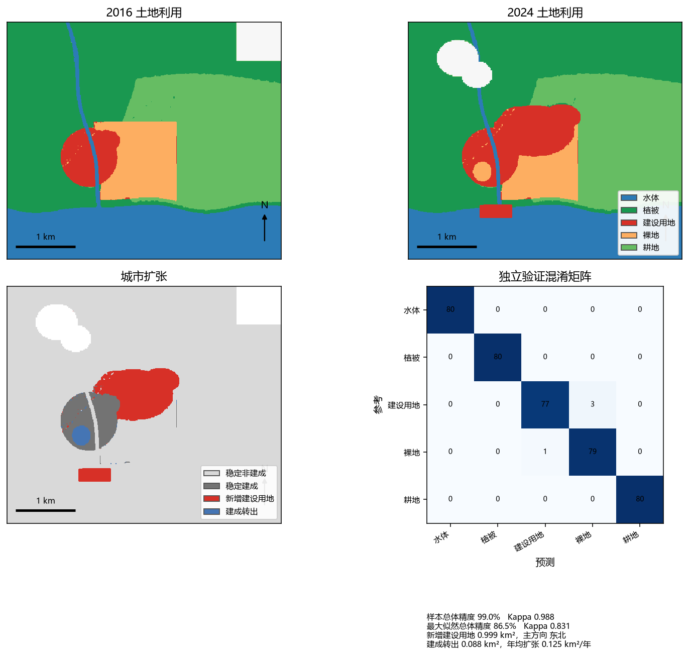

# 珠海横琴 Sentinel-2 土地利用分类与城市扩张

用两期 Sentinel-2 式影像做五类监督分类，再提取新增建设用地。随机森林独立验证总体精度 **99.0%**，Kappa **0.9875**；2016–2024 年新增建设用地 **0.9995 km²**，主方向为东北。



这是教学示例景上的实测结果，不是 Copernicus 原景测出来的横琴扩张。换真实景的步骤见下文。完整分析在 [docs/report.md](docs/report.md)。

## 精度

| 路线 | 总体精度 | Kappa | 验证样本 |
| --- | --- | --- | --- |
| 随机森林（制图所用） | 99.0% | 0.9875 | 400 |
| 高斯最大似然 | 86.5% | 0.831 | 400 |
| 建成 / 非建成（随机森林合并后） | 99.0% | 0.968 | 400 |

随机森林混淆矩阵（行是参考，列是预测）：

| 参考 \ 预测 | 水体 | 植被 | 建设用地 | 裸地 | 耕地 |
| --- | ---: | ---: | ---: | ---: | ---: |
| 水体 | 80 | 0 | 0 | 0 | 0 |
| 植被 | 0 | 80 | 0 | 0 | 0 |
| 建设用地 | 0 | 0 | 77 | 3 | 0 |
| 裸地 | 0 | 0 | 1 | 79 | 0 |
| 耕地 | 0 | 0 | 0 | 0 | 80 |

各类 F1：水体 1.000，植被 1.000，建设用地 0.975，裸地 0.975，耕地 1.000。错分只出现在建设用地和裸地之间。

## 数据来源

研究区是珠海横琴外包矩形（113.490°E–113.535°E，22.110°N–22.145°N），投影到 EPSG:32649，10 m 网格 396×458，约 18.14 km²。时相为 2016-10-18 与 2024-10-12，云量阈值按 <10% 设计。

默认 `mode: demo` 会在本地生成教学示例景：反射率按 Sentinel-2 L2A 的量级写成 DN×10000，B02/B03/B04/B08 为 10 m，B11/B12/SCL 为 20 m。它用来把预处理、分类和变化检测跑通，**不能当成横琴的官方扩张统计**。大体积原始影像不进仓库，`data/demo/` 与 `data/raw/` 已在 `.gitignore` 中。

真实 L2A 的取法：

1. [Copernicus Browser](https://browser.dataspace.copernicus.eu/)：导入 `data/aoi/hengqin.geojson`，选 Sentinel-2 L2A，云量 <10%，分别取 2016 年秋季和 2024 年秋季，下载 B02、B03、B04、B08、B11、B12、SCL。
2. 无账号的公开 COG：`python scripts/download_sentinel.py --period t1` 先检索，确认后再加 `--download`。检索走 Element84 Earth Search。
3. Google Earth Engine：`scripts/gee_export_hengqin.js`，产品为 `COPERNICUS/S2_SR_HARMONIZED`。

L2A 已经是 Sen2Cor 地表反射率，并带有几何校正。本项目不再做 DOS1。云和云影用 SCL 的 0、1、3、8、9、10、11 掩掉。

## 方法

1. 把 20 m 波段重采样到 10 m：反射率双线性，SCL 最近邻，并检查两期网格。本示例偏移为 0.00 m。
2. 指数（分母过小记为无效，避免 NoData 假值）：
   - NDVI = (B08 − B04) / (B08 + B04)
   - NDBI = (B11 − B08) / (B11 + B08)
   - MNDWI = (B03 − B11) / (B03 + B11)
   - NDWI_SWIR = (B08 − B12) / (B08 + B12)，与 IndiaSAT 的 NDWI 一致
3. 特征为六个反射率波段加上上述四个指数。随机森林 100 棵树，`random_state` 为 42。
4. 五个类别：水体、植被、建设用地、裸地、耕地。示例景的参考图只用来模拟目视解译；样本取自腐蚀后的纯净像元，训练块和验证块不重叠。两期合计训练 800、验证 400。
5. 同一套样本再训一个高斯最大似然，用来对照，不参与出图。
6. 分类图做 3×3 众数滤波后再比较。新增建设用地 = 非建成→建成；建成转出 = 建成→非建成。面积用 10 m×10 m 像元，方向相对 2016 年建成区质心划分八个扇区。

## 复现

```bat
python -m venv .venv
.venv\Scripts\activate
pip install -r requirements.txt
python -m landcover
python -m pytest
```

也可以用 `python scripts/run_pipeline.py`。配置在 `config/config.yaml`，路径都相对项目根目录。conda 环境见 `environment.yml`。

跑完后看：

- `outputs/figures/overview.png`：首屏图
- `outputs/maps/class_t1.tif`、`class_t2.tif`、`change.tif`：可放进 QGIS
- `outputs/tables/metrics.json`：精度、面积、方向

## 结果与结论

在两期都有效的 17.19 km² 上，建设用地从 0.715 km² 增至 1.626 km²。新增 0.9995 km²，相当于 2016 年建成区的 140%，占有效区的 5.8%，约 0.125 km²/年。建成转出 0.0887 km²。

新增像元里，东北 0.527 km²、东 0.296 km²、南 0.126 km²。扩张质心在 2016 年建成区质心的 67.2° 方向、0.78 km 处，即东北偏东；南侧一小块对应示意性的岸线外推。转移矩阵里，新增主要来自裸地（0.537 km²）和耕地（0.236 km²）。

随机森林的重要度最高的是 B11、B08、B12。最大似然只有 86.5%，差距主要在建成与裸地、植被与耕地，这和这两对光谱靠近是一致的。

## 在 QGIS 里重做

菜单级步骤、SCP 波段集、ROI、随机森林或最大似然、精度和变化检测写在 [qgis/qgis_workflow.md](qgis/qgis_workflow.md)。样式：

- `qgis/styles/landcover.qml`：五类
- `qgis/styles/change.qml`：扩张
- `qgis/styles/ndvi.qml`：NDVI

装有 QGIS 时，在 Python 控制台运行 `qgis/apply_styles.py` 可加载结果并套用样式。本机命令行环境没有 QGIS，因此没有在打印布局里再导出一张版面；上图是同一套配色的 Matplotlib 图。

## 换成真实景

1. 把两个时相的波段和 SCL 放到 `data/raw/t1`、`data/raw/t2`，文件名与示例景相同。
2. 在 QGIS 里为两个时相各采训练点和独立验证点，导出时保留 `period`（t1/t2）、`split`（train/val）、`class_id`、`row`、`col`。CSV 格式可参照 `outputs/samples/`。`row`/`col` 必须是对齐到 t1 网格之后的行列号。
3. 把 `config/config.yaml` 的 `mode` 改成 `external`，再运行 `python -m landcover`。
4. 真实景上建成/裸地、耕地/植被会更难分。总体精度低于 85% 时，先改样本，不要改种子凑数。

## 局限与致谢

- 默认数字来自光谱可分性偏高的示例景。全图对照参考图的总体精度是 99.5%，不能外推到真实横琴。
- 样本来自纯净像元，边界混合像元的难度被故意压低了。
- 只做了分类后比较，没有 IndiaSAT 那种半年合成和时序纠错。两期错分会直接进扩张面积。
- 类别定义和目视样本都有主观性。示例里的“耕地/植被”边界是规则生成的。
- 数据致谢：方法所针对的原始数据是 Copernicus Sentinel-2（© European Union，Copernicus 计划）。本仓库默认不包含这些原始像元。

许可证：MIT。

## 参考

- IndiaSAT：<https://github.com/ICTD-IITD/IndiaSAT>。本项目沿用其随机森林、NDVI/NDBI、云量筛选，以及建成/非建成和“稳定建成、稳定非建成、新增”的变化编码；类别按指南拆成五类，输入改为 L2A + SCL，而不是原仓库脚本里的 L1C + QA60。
- Luca Congedo，From GIS to Remote Sensing，Basic Tutorial 2：<https://fromgistors.blogspot.com/2016/09/basic-tutorial-2.html>。清单中的 `fromgists.blogspot.com` 当前返回 404，实际教程在 `fromgistors.blogspot.com`。QGIS 步骤按该教程的下载、反射率、裁剪、波段集、ROI、光谱检查和分类来写。
- Rouse 等，NDVI；Zha、Gao、Ni，NDBI（2003）；Xu，MNDWI（2006）；Cohen，Kappa（1960）。
- Sentinel-2 L2A 与 SCL：Copernicus Sentinel-2 User Guide。
